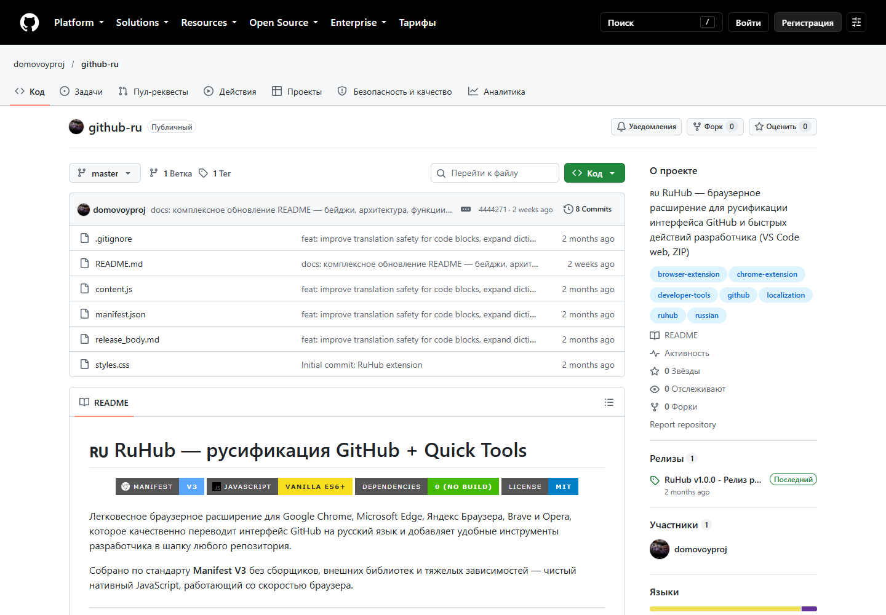

# RuHub

Расширение для перевода элементов GitHub на русский язык. Работает в браузере на страницах `github.com`, без отдельного сервера и сборки.

Страница репозитория в Chromium с загруженным расширением: переведены вкладки, поиск и часть кнопок. Некоторые элементы остаются на английском.

## Возможности

- Перевод навигации, кнопок и подписей по встроенному словарю.
- Перевод совпадающих `aria-label`, `placeholder`, `title` и `data-content`.
- Повторная обработка после динамических изменений страницы.
- Исключение блоков кода, diff и редакторов из обычного текстового перевода.
- Дополнительные ссылки на веб-редактор `github.dev` и ZIP-архив репозитория, если на странице найдена ожидаемая панель действий.

Расширение меняет отображение страницы в вашем браузере. Оно не переводит исходники репозитория и не отправляет их в сервис перевода.

## Установка

1. [Скачайте исходники](https://github.com/domovoyproj/github-ru/archive/refs/heads/master.zip) и распакуйте архив.
2. Откройте страницу расширений: `chrome://extensions/`, `edge://extensions/` или `browser://extensions/` в Яндекс Браузере.
3. Включите режим разработчика и выберите «Загрузить распакованное расширение».
4. Укажите папку, содержащую `manifest.json`, и обновите страницу GitHub.

Текущая версия манифеста — 1.0.1, Manifest V3. В этой проверке расширение запущено в Chromium; остальные браузеры на этом ПК отдельно не проверялись.

## Ограничения

Перевод заменяет только точные совпадения из словаря. Длинные фразы, пользовательские тексты и новые элементы интерфейса могут остаться без перевода.

Добавление кнопок зависит от разметки GitHub: код ищет `ul.pagehead-actions`. На проверенной современной странице такой панели не было, поэтому кнопки VS Code и ZIP не появились. Перевод навигации при этом работает.

## Изменение словаря

Добавьте пару «исходная фраза → перевод» в `DICTIONARY` в файле `content.js`. Ключи записываются в нижнем регистре. Затем перезагрузите расширение на странице управления и обновите GitHub.

`content.js` содержит словарь, обработку DOM и дополнительные ссылки; `styles.css` оформляет эти ссылки; `manifest.json` задаёт страницы подключения. Зависимостей и шага сборки нет.

Автор: [domovoyproj](https://github.com/domovoyproj). Лицензия: MIT.
